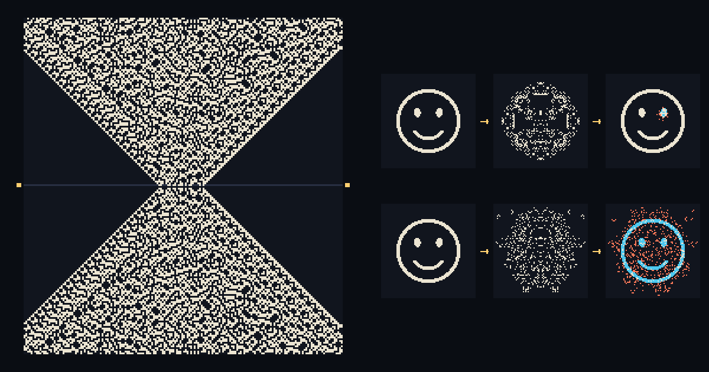

# Loschmidt

**Try it in the browser: [adb991.github.io/loschmidt](https://adb991.github.io/loschmidt/)**



An explorer for **reversible binary cellular automata** in one and two dimensions, built to look at thermalisation, typicality, ergodicity and recurrence in systems whose microscopic dynamics is exactly invertible.

Every rule here is a bijection on configurations of a periodic board, so a single time slice fixes the whole history, past and future. Click any cell, at any time, and the history is rewritten in both directions.

- **1D** rules are drawn as a space-time diagram, with the future above the present and the past below it.
- **2D** rules play as a video, forwards or backwards.

The name comes from Loschmidt's reversibility objection (*Umkehreinwand*, 1876) to Boltzmann's H-theorem: reverse every velocity of a thermalised gas and the microscopic dynamics carries it back to its low-entropy start.

Andrea Di Biagio designed the explorer and its experiments; Claude (Opus 5.5) wrote the code, checked the rule catalogue against the literature, and wrote the tests.

## Running it

No build step and no dependencies to install. Open `index.html` in a browser, or serve the folder:

```bash
python3 -m http.server 8000
```

On GitHub Pages it works as-is from the repository root. KaTeX and the fonts load from CDNs; without a network the formulas show as TeX source and everything else works.

## Experiments

**Thermalisation.** Start from a low-entropy pattern (a smiley, a block, a gas confined to a box or half the board) and watch the coarse-grained entropy rise to its typical value. It rises in both time directions away from t = 0. Start from an iid random board and nothing macroscopic happens.

**Typicality depends on the rule.** The *Typicality* panel reports, for the present time slice,

| measure | definition | typical (iid at density ρ) |
|---|---|---|
| density ρ | fraction of live cells | — |
| coarse-grained entropy | $\frac{1}{N}\sum_{\text{blocks}} \log_2 \binom{b}{n_\text{block}}$, the Boltzmann entropy of block occupation numbers | $\mathbb{E}\big[\log_2 \binom{b}{K}\big]/b$, $K \sim \mathrm{Bin}(b, \rho)$ |
| block entropy | Shannon entropy of 3-cell (1D) or 2×2 (2D) patterns, per cell | $h(\rho)$ |
| unlike bonds | fraction of nearest-neighbour pairs that differ (domain-wall density, the Ising energy) | $2\rho(1-\rho)$ |

Particle-conserving rules thermalise at fixed density. Q2R conserves the Ising energy, so its equilibrium is clustered, with a fixed density of domain walls. Free and integrable rules (ballistic gas, diagonal gas, RCA54, box-ball system) never reach the iid values.

**Ergodicity.** The *Ergodicity* panel keeps, for every cell, its time average over a window $[t_0, t]$ and compares it with the space average at time $t$. Probes (⌖, or ⌥/Alt-click) follow single cells. The histogram shows the time averages of all cells, with the band a coin-flip process would give. In 2D, *show time averages* paints the map: a free gas leaves the imprint of its conserved velocities.

**Loschmidt echo.** Four buttons: encode a low-entropy pattern at t = 0, scramble it forwards to t = T, flip one (or k) random cells, run back to t = 0. Without the flip the pattern returns exactly. With it, the damage at t = 0 is the backward light cone of the flip: small after a short scramble, everywhere after a long one. In linear rules the light cone is a sparse fractal and the pattern survives. In integrable rules the flip creates a few quasiparticles rather than a filled cone.

At step 3 you can also click cells yourself: the echo records them as the perturbation. The ◎ light cone and ◐ damage buttons (mirrored in the echo panel) are independent: both off shows the plain pattern, the light cone alone shows the area of effect.

**Light cone and damage.** ◎ Light cone shades the causal light cone of the last toggle: every cell whose value could depend on the toggled one, computed from the rule's update structure (neighbourhood, blocks, sublattices, layers) whatever the cell values. While it is on, each toggle is compared with the history just before it. ◐ Damage colours the cells that actually changed: red for on now but off in the reference, blue for the reverse. The panel reports both edges: the light cone's, and the damage front's, which moves at the butterfly speed and can be slower. In 1D, hovering previews the next toggle.

**Unfolding.** In 1D an edit doesn't appear everywhere at once: the new history spreads outwards from the edited row at four rows per play step, into the future and the past, so you can follow its consequences. Setting a new pattern at t = 0 unfolds the same way.

**Recurrence.** The board is finite, so every orbit is a cycle (Zermelo's objection). The *Recurrence* panel watches for a return to the exact t = 0 microstate. Small boards and linear rules come back quickly; the bound is the size of the state space.

## Rules

Conservation laws marked ✓ are shown live in the Typicality panel and checked numerically by the test suite.

**1D** (each row of the diagram is one step; for staggered and layered rules, one half-step or one layer)

| rule | family | conserves | character | source |
|---|---|---|---|---|
| RCA54 | staggered, f = OR | ✓ left and right soliton numbers | interacting, integrable | Bobenko et al. 1993; Buča, Klobas, Prosen 2021 |
| RCA201 · Floquet PXP | staggered, f = NOR | frozen 11 pairs; three cycling vacua | interacting, integrable, fragmented | Wilkinson, Klobas, Prosen, Garrahan 2020 |
| RCA150 · 1D Q2R | staggered, f = XOR | ✓ domain walls | free, linear | Inoue & Takesue 2018; Prosen 2021 |
| RCA105 | staggered, f = XNOR | — | affine | Bobenko et al. 1993 |
| 26R · Takesue | second order | ✓ kink energy K | thermalises at fixed K; Fourier's law | Takesue 1989, 1990 |
| 214R | second order | none (local) | chaotic, thermalises to iid | Shiraishi 2018 |
| 90R | second order | ✓ K_R and K_L separately | free chiral kinks, linear | Takesue 1989; Lindgren & Olbrich 2017 |
| 150R | second order | none (local) | looks random, linear | Wolfram 2002 |
| 37R | second order | ✓ frozen 2×2 blocks | order–disorder fluctuations | Wolfram 2002 |
| SCARVES | second order, radius 2 | ✓ kink energy K₂ | many interacting particles | Bennett, in Toffoli & Margolus 1990 |
| Folded XXZ | controlled swaps | ✓ particles | interacting, integrable, local | Pozsgay 2021 |
| Ballistic gas | 2-cell blocks, swap | ✓ particles (left and right separately) | free | Toffoli & Margolus 1987 |
| Box-ball system | nonlocal | ✓ particles; solitons | integrable | Takahashi & Satsuma 1990; Yura & Tokihiro 2002 |

A staggered rule with flip function $f(s_{i-1}, s_{i+1})$ is two decoupled copies of the second-order rule with $f(a, b, c) = f(a, c)$: RCA54 ↔ 250R, RCA201 ↔ 5R, RCA150 ↔ 90R, RCA105 ↔ 165R. The two numberings are unrelated otherwise.

**2D**

| rule | family | conserves | character | source |
|---|---|---|---|---|
| Critters | Margolus | ✓ N in the dual view | gliders, thermalises, universal | Margolus; Toffoli & Margolus 1987 |
| Billiard Ball Model | Margolus | ✓ particles | billiard-ball collisions, universal | Margolus 1984 |
| HPP gas | Margolus | ✓ particles, momentum (and per-line momentum) | lattice gas | Hardy, de Pazzis, Pomeau 1976; Toffoli & Margolus 1987 |
| TM gas | Margolus, alternating | ✓ particles, momentum | lattice gas, better mixing | Toffoli & Margolus 1987 |
| Schaeffer | Margolus | ✓ particles | physically universal | Schaeffer 2015 |
| Bounce gas | Margolus | ✓ particles | bouncing particles | Tyler (MCell) |
| Single Rotation | Margolus | ✓ particles | chiral, spaceships | Shintyakov (js-revca) |
| Tron | Margolus | — | expanding fronts | Toffoli & Margolus 1987 |
| Free diagonal gas | Margolus, 180° rotation | ✓ particles (four velocity classes) | free | Toffoli & Margolus 1987 |
| Q2R · Ising | checkerboard, flip on 2 | ✓ Ising energy | microcanonical Ising | Vichniac 1984; Pomeau 1984 |
| Checkerboard parity | checkerboard, flip on 1, 3 | — | linear | Toffoli & Margolus 1987 |
| Life R | second order, B3/S23 | — | chaotic | Toffoli & Margolus 1987 |
| Parity R | second order, vN XOR | — | linear, replicating | Toffoli & Margolus 1987 |

Margolus tables use the Golly/MCell index UL + 2·UR + 4·LL + 8·LR; Critters is `15,14,13,3,11,5,6,1,7,9,10,2,12,4,8,0`.

No first-order elementary rule is reversible except the trivial ones (identity, complement, shifts), which is why the second-order, staggered and partitioned constructions exist.

Each rule has editable parameters, so the families contain many more rules than the presets: any of the 256 second-order elementary rules, any of the 16 staggered rules, any permutation of 2×2 blocks (alternating with the parity of t if you like), any set of flip counts on the checkerboard, any Life-like B/S rule made reversible by Fredkin's trick. Badges (particle-conserving, linear, conserved Ising energy, …) are computed from the parameters.

## How it works

- **Boundary conditions.** The board is a torus. Periodic boundaries keep translation invariance, add no boundary rule that could break reversibility or conservation laws, and make the state space finite, so recurrence is guaranteed. Block and staggered rules need even side lengths; all board sizes are multiples of 16.
- **Second-order rules.** Fredkin's trick $x^{t+1} = F(x^t) \oplus x^{t-1}$ is reversible for any $F$: $x^{t-1} = F(x^t) \oplus x^{t+1}$. The microstate is the pair $(x^{t-1}, x^t)$; toggling a cell at time t changes $x^t$ and keeps $x^{t-1}$.
- **Partitioned rules.** Margolus block rules apply a permutation of the 16 block states on a partition that shifts by (1, 1) each step; the inverse applies the inverse permutation on the previous partition. Staggered rules update one sublattice at a time with neighbours frozen, so each half-step is an involution.
- **Histories.** A history is stored as one anchor slice plus snapshots every 32 steps. Any time is reached by stepping from the nearest snapshot, so scrubbing far into the past or future is cheap and editing a cell is O(1): it just moves the anchor.
- **Light cones.** Each rule family also has an influence stepper acting on masks: one step marks every cell whose new value can depend on a marked cell. The test suite checks, for every rule, that each cell that actually changes after a flip lies inside the cone.
- **Boards.** 1D rings of 96 to 960 cells; 2D tori of 64² to 1024².
- **Colours.** Two themes, Paper (light, the default) and Mono (black and white), switched from the swatches in the header and remembered in the browser.
- **Speed.** Presets from 3 to 1000 steps per second, plus *max*, which runs as many steps as fit in each frame and reports the rate it reaches.
- **Dual view.** Critters maps N live cells to WH − N each step. With *complement odd frames* on (the default), odd frames are drawn complemented, which makes N conserved and the dynamics visible.

## Code

```
index.html        layout
css/style.css     styling
js/rules.js       engines, rule families, catalogue, property analysis
js/history.js     a full trajectory: anchor + snapshots + walker
js/measures.js    typicality measures and their iid values
js/patterns.js    initial conditions
js/app.js         rendering, interaction, experiments
test/             reversibility.js (the test suite), thumbnail.js (renders thumbnail.png)
```

`node test/reversibility.js` checks every preset: step∘unstep and unstep∘step are the identity at several densities and time parities, every conservation law a rule declares holds forwards and backwards, every cell changed by a flip lies inside the light cone, and the history cache is consistent under random access and toggle/untoggle. `node test/thumbnail.js eca2-214 critters` redraws the preview image from the engines.

## Keys

| key | action |
|---|---|
| Space / Shift+Space | play–pause / play backwards |
| ← → (Shift ×10) | step |
| Home or 0 | jump to t = 0 |
| Z | run to t = 0 at high speed |
| [ / ] | slower / faster |
| R | reverse |
| L | light cone |
| P / X | pin / clear reference |
| D | damage colours |
| A | time-average map (2D) |
| 1 / 2 | 1D / 2D |
| wheel | scroll in time |

## References

- T. Toffoli & N. Margolus, *Cellular Automata Machines* (MIT Press, 1987).
- T. Toffoli & N. Margolus, Invertible cellular automata: a review, *Physica D* 45, 229 (1990). [pdf](https://people.csail.mit.edu/nhm/ica.pdf)
- N. Margolus, Physics-like models of computation, *Physica D* 10, 81 (1984).
- N. Margolus, Crystalline computation (1999). [arXiv:comp-gas/9811002](https://arxiv.org/abs/comp-gas/9811002)
- G. Y. Vichniac, Simulating physics with cellular automata, *Physica D* 10, 96 (1984).
- Y. Pomeau, Invariant in cellular automata, *J. Phys. A* 17, L415 (1984).
- H. Takesue, Reversible cellular automata and statistical mechanics, *Phys. Rev. Lett.* 59, 2499 (1987).
- H. Takesue, Ergodic properties and thermodynamic behavior of elementary reversible cellular automata I, *J. Stat. Phys.* 56, 371 (1989).
- H. Takesue, Fourier's law and the Green–Kubo formula in a cellular-automaton model, *Phys. Rev. Lett.* 64, 252 (1990).
- A. Bobenko, M. Bordemann, C. Gunn, U. Pinkall, On two integrable cellular automata, *Commun. Math. Phys.* 158, 127 (1993).
- B. Buča, K. Klobas, T. Prosen, Rule 54: exactly solvable model of nonequilibrium statistical mechanics, *J. Stat. Mech.* 074001 (2021). [arXiv:2103.16543](https://arxiv.org/abs/2103.16543)
- J. W. P. Wilkinson, K. Klobas, T. Prosen, J. P. Garrahan, Exact solution of the Floquet-PXP cellular automaton, *Phys. Rev. E* 102, 062107 (2020). [arXiv:2006.06556](https://arxiv.org/abs/2006.06556)
- T. Prosen, Reversible cellular automata as integrable interactions round-a-face (2021). [arXiv:2106.01292](https://arxiv.org/abs/2106.01292)
- A. Inoue & S. Takesue, Two extensions of exact nonequilibrium steady states of a boundary-driven cellular automaton, *J. Phys. A* 51, 425001 (2018). [arXiv:1806.07099](https://arxiv.org/abs/1806.07099)
- N. Shiraishi, Analytic model of thermalization: quantum emulation of classical cellular automata, *Phys. Rev. E* 97, 062144 (2018). [arXiv:1709.06315](https://arxiv.org/abs/1709.06315)
- K. Lindgren & E. Olbrich, The approach towards equilibrium in a reversible Ising dynamics model, *J. Stat. Phys.* 168, 919 (2017). [arXiv:1703.10527](https://arxiv.org/abs/1703.10527)
- B. Pozsgay, A Yang–Baxter integrable cellular automaton with a four site update rule, *J. Phys. A* 54, 384001 (2021). [arXiv:2106.00696](https://arxiv.org/abs/2106.00696)
- D. Takahashi & J. Satsuma, A soliton cellular automaton, *J. Phys. Soc. Jpn.* 59, 3514 (1990).
- F. Yura & T. Tokihiro, On a periodic soliton cellular automaton, *J. Phys. A* 35, 3787 (2002). [arXiv:nlin/0112041](https://arxiv.org/abs/nlin/0112041)
- J. Hardy, O. de Pazzis, Y. Pomeau, Molecular dynamics of a classical lattice gas, *Phys. Rev. A* 13, 1949 (1976).
- L. Schaeffer, A physically universal cellular automaton, ITCS 2015. [ECCC TR14-084](https://eccc.weizmann.ac.il/report/2014/084/)
- S. Wolfram, *A New Kind of Science* (2002), pp. 437–454.
- D. Shintyakov, js-revca, a reversible cellular automata simulator. [dmishin.github.io/js-revca](https://dmishin.github.io/js-revca/)
